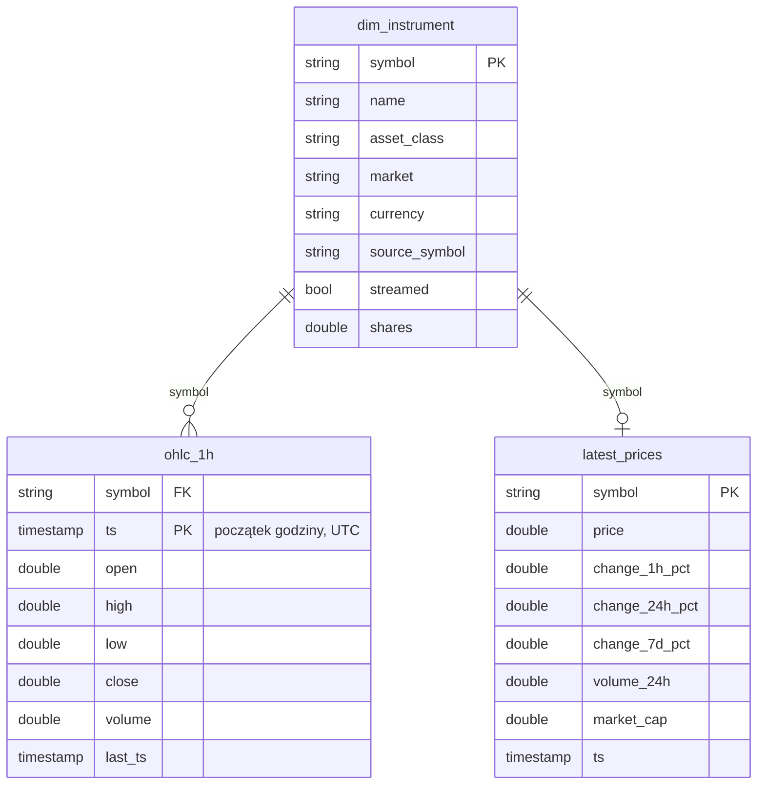

# Konwencja Lakehouse — GeoMarket Intelligence

Autor: Sebastian Michulec. Wersja 1.2 (18.11.2026). Obowiązuje oba potoki: strumieniowy (notowania) i wsadowy (makro, newsy, GDELT, wyniki AI).

Słowa **MUSI** oznaczają wymóg, bez którego dane z obu potoków nie tworzą jednego Lakehouse. **ZALECANE** to dobra praktyka, której brak nie psuje integracji.

## 1. Idea

Lakehouse to jedno wspólne miejsce na dane analityczne. Tabele są w otwartym formacie Delta Lake (pliki Parquet + dziennik transakcji `_delta_log`), co daje:

- atomowe zapisy: odczyt nigdy nie widzi połowy zapisu,
- historię wersji (time travel): `DeltaTable(ścieżka, version=n)`,
- wymuszanie schematu: zapis z innymi kolumnami lub typami kończy się błędem, a nie cichym zepsuciem tabeli.

Każdy potok pisze **własnym kodem do własnych tabel**. Wspólne są tylko zasady z tego dokumentu oraz tabele, które jeden potok czyta od drugiego (sekcja 6).

## 2. Katalog główny (MUSI)

- Wszystkie tabele leżą pod jednym katalogiem `LAKEHOUSE_ROOT` (zmienna środowiskowa).
- Lokalnie domyślnie `<repozytorium>/data/lakehouse`. Katalog `data/` jest wykluczony z Gita w głównym `.gitignore`.
- W Docker Compose oba serwisy montują ten sam wolumen pod `/data/lakehouse` i ustawiają `LAKEHOUSE_ROOT=/data/lakehouse`.
- Ścieżki **nie mogą** zależeć od katalogu, z którego uruchomiono serwis. Ścieżka względna `data/` przy innym katalogu roboczym tworzy drugie, osobne „jezioro”.

## 3. Struktura i nazewnictwo

```
{LAKEHOUSE_ROOT}/{warstwa}/{domena}/{tabela}
```

- `warstwa`: `bronze` | `silver` | `gold` (MUSI).
- `domena`: obszar danych z jednym właścicielem (MUSI, tabela w sekcji 5).
- `tabela`: `snake_case`, małe litery, cyfry i `_` (MUSI). Bez symboli instrumentów w nazwie (np. `EURPLN=X`). Symbol jest kolumną, nie częścią ścieżki.
- Nazwy kolumn: `snake_case`, małe litery (MUSI).

| Warstwa | Zawartość | Typowy tryb zapisu |
| --- | --- | --- |
| `bronze` | Surowe dane ze źródła, bez poprawek, z metadanymi pobrania | `append` |
| `silver` | Dane oczyszczone, z poprawnymi typami, zdeduplikowane, z historią | `merge` (upsert po kluczu) lub `append` + deduplikacja |
| `gold` | Agregaty i wyniki gotowe dla API, frontendu i AI | `overwrite` (migawka) lub `merge` |

Wszystkie trzy warstwy są tabelami Delta (MUSI dla `silver` i `gold`, ZALECANE dla `bronze`). W Bronze surowa odpowiedź API może być jedną kolumną tekstową `payload` (JSON jako string).

## 4. Typy i czas

- Czas zawsze w **UTC**, typ `timestamp` ze strefą (`pa.timestamp("us", tz="UTC")`) (MUSI).
- `ts`: czas obserwacji, którego dotyczy wartość (np. czas notowania, data publikacji wskaźnika) (ZALECANE).
- `ingested_at`: czas zapisu do Lakehouse (MUSI w każdej tabeli).
- Liczby jako `double` lub `int64`, nie tekst (MUSI w `silver` i `gold`). Procenty jako liczba procentów (`2.5` = 2,5%).
- Brak wartości: `null`, nie `0` ani `""`.

## 5. Domeny i właściciele

Jedna tabela ma jednego właściciela, który do niej pisze (MUSI). Pozostali tylko czytają. Unikamy w ten sposób równoczesnych zapisów do tej samej tabeli z dwóch serwisów.

| Domena | Właściciel | Zawartość |
| --- | --- | --- |
| `market` | Sebastian (potok strumieniowy) | Notowania akcji, indeksów, walut, surowców, kryptowalut |
| `macro` | Patryk (potok wsadowy) | Wskaźniki makroekonomiczne (FRED, dane PL i UE) |
| `news` | Patryk | Artykuły (RSS, NewsAPI) |
| `gdelt` | Patryk | Wydarzenia geopolityczne GDELT |
| `ai` | Patryk | Wyniki analiz LLM (sentyment, analizy, AI Impact) |

Obecne ścieżki potoku wsadowego (`silver/macro/<wskaźnik>`, `silver/gdelt/events_delta`) są zgodne ze schematem `warstwa/domena/tabela`.

## 6. Tabele domeny `market` (Sebastian)

Zaimplementowane w etapie 3 (`backend/app/stream/lakehouse.py`). Kolumny oznaczone ★ to **kontrakt** dla innych potoków: nie zmieniają się bez uzgodnienia, nowe kolumny mogą dochodzić.

| Tabela | Warstwa | Klucz (MERGE) | Partycje | Zawartość |
| --- | --- | --- | --- | --- |
| `bronze/market/raw_messages` | Bronze | — (append) | `ingest_date` | surowe wiadomości z Kafki: `topic`, `kafka_partition`, `kafka_offset`, `message_key`, `kind`, `source`, `fetched_at`, `payload` (JSON), `parse_error`, `ingested_at` |
| `silver/market/bars` | Silver | `symbol`, `interval`, `ts` | `date` | oczyszczone świece: `interval` = `1h` (historia) albo `1m` (strumień), `open`, `high`, `low`, `close`, `volume`, `source`, `fetched_at`, `ingested_at` |
| `silver/market/instrument_info` | Silver | `symbol` | — | liczba akcji spółek (`shares`), `currency`, `exchange` |
| `silver/market/crypto_markets` | Silver | `id`, `ts` | `date` | notowania TOP 100 kryptowalut (CoinGecko) z 7-dniową serią `sparkline_7d` |
| `gold/market/ohlc_1h` | Gold | `symbol`, `ts` | — | świece godzinowe łączące historię i strumień; `last_ts` = czas ostatniego notowania w świecy |
| `gold/market/latest_prices` | Gold | `symbol` | — | **ostatnia cena każdego instrumentu — jedno źródło cen w systemie** |
| `gold/market/crypto_top` | Gold | — (overwrite) | — | ostatnia migawka TOP 100 kryptowalut |
| `gold/market/dim_instrument` | Gold | — (overwrite) | — | wymiar instrumentów (katalog + liczba akcji) |

**`gold/market/latest_prices`** (kontrakt dla AI): `symbol`★ (np. `AAPL`, `PKN`, `EUR/PLN`, `OIL`, `WIG20`), `name`★, `asset_class`★ (`stock` | `index` | `fx` | `commodity`), `currency`★, `price`★, `change_24h_pct`★ (%, null gdy brak danych sprzed 24 h), `ts`★ (czas ostatniego notowania, UTC), `change_1h_pct`, `change_7d_pct`, `volume_24h`, `market_cap`, `ingested_at`.

**`gold/market/dim_instrument`**: `symbol`★, `name`★, `asset_class`★, `market` (`US` | `PL`), `currency`★, `unit`, `source` (`yahoo`), `source_symbol` (np. `PKN.WA`, `EURPLN=X`), `streamed` (false = brak notowań w źródle), `shares`, `ingested_at`.

Kryptowaluty są w osobnych tabelach (`crypto_markets`, `crypto_top`), identyfikowane przez `id` z CoinGecko (np. `bitcoin`).

Zmiany względem wersji 1.0: `silver/market/prices` → `silver/market/bars` (pełne świece OHLC zamiast pojedynczej ceny, partycje po `date` zamiast `asset_class`), `gold/market/ohlc` → `gold/market/ohlc_1h`, `bronze/market/quotes_raw` → `bronze/market/raw_messages`. Kontrakt `latest_prices` bez zmian.

### Odczyt cen przez potok wsadowy / AI

```python
from deltalake import DeltaTable
import os

root = os.environ["LAKEHOUSE_ROOT"]
df = DeltaTable(f"{root}/gold/market/latest_prices").to_pandas()
row = df[df["symbol"] == "AAPL"]
```

Uwaga techniczna: MERGE w delta-rs zapisuje kolumny tekstowe w typie Arrow `string_view`. Filtry `to_pyarrow_dataset()` / `to_pyarrow_table(filters=...)` nie porównują go ze zwykłym `string` (błąd `ArrowNotImplementedError`). Odczyt całej tabeli (`to_pandas()`, jak wyżej) działa; do filtrowania po stronie biblioteki służy `deltalake.QueryBuilder` (SQL).

## 7. Model danych analitycznych

Schemat gwiazdy domeny `market`: wymiar `dim_instrument` połączony po `symbol` z tabelami faktów `ohlc_1h` (szereg czasowy) i `latest_prices` (stan bieżący).



Analogicznie zalecany dla domeny `macro`: wymiar wskaźników (`indicator`, `name`, `country`, `unit`, `frequency`) i fakty obserwacji (`indicator`, `ts`, `value`).

## 8. Kontrakt danych makro (serwis AI → bramka)

Wskaźniki makro dla zakładki Makro bramka pobiera z serwisu AI (potok wsadowy), a nie z jego tabel w Lakehouse. Stan na 18.11.2026 (kod `backend-ai/app/data_sources/fred.py`, `services/macro_service.py`).

**Źródło:** `GET {AI_SERVICE_URL}/stock/macro/raw` (wewnętrznie `http://backend-ai:8001`). Bramka trzyma odpowiedź 60 min (dane są miesięczne lub kwartalne), czeka na nią najwyżej 10 s.

**Format odpowiedzi:** obiekt JSON z kluczami wskaźników; każdy ma postać

```json
{"date": "2026-09-01", "value": "3.1", "history": [{"date": "2026-07-01", "value": 3.6}, {"date": "2026-08-01", "value": 3.4}]}
```

- `date`: data ostatniego odczytu `YYYY-MM-DD` albo `"N/A"`,
- `value`: ostatnia wartość jako **napis** z liczbą albo `"N/A"` (brak danych lub brak klucza FRED),
- `history`: do 12 ostatnich odczytów `{date, value: liczba}`, od najstarszego.

| Klucz | Seria FRED | Jednostka | Symbol w zakładce Makro |
| --- | --- | --- | --- |
| `CPI_PL` | POLCPIALLMINMEI | % r/r | CPI PL |
| `CPI_Inflation` | CPIAUCSL | % r/r | CPI USA |
| `CPI_EU` | CP0000EZ19M086NEST | % r/r | CPI EU |
| `RATES_PL` | IRSTCI01PLM156N | % | NBP RATE (stopa międzybankowa, nie referencyjna NBP) |
| `Fed_Interest_Rate` | FEDFUNDS | % | FED RATE |
| `RATES_EU` | ECBDFR | % | ECB RATE (stopa depozytowa) |
| `GDP_PL` | CLVMNACSCAB1GQPL | % r/r | GDP PL |
| `GDP` | GDP | % r/r | GDP USA |
| `GDP_EU` | CLVMEURSCAB1GQEA19 | % r/r | GDP EU |

**Przetwarzanie w bramce:** napis → liczba, `"N/A"` → `null`, data → ISO 8601 UTC, historia sortowana rosnąco, `change` = różnica w punktach procentowych między dwoma ostatnimi odczytami. Serwis AI niedostępny → `value: null`, `history: []`, `source: "unavailable"` (kursy i surowce działają dalej).

**Zmiany kontraktu:** zmiana kluczy, pól albo jednostek po stronie serwisu AI wymaga wcześniejszej informacji dla bramki. Dane testowe kontraktu: `backend/tests/test_market.py` (`MACRO_RAW`).

## 9. Czego nie robimy

- Nie zapisujemy danych z Lakehouse do Gita.
- Nie piszemy do cudzych tabel.
- Nie zmieniamy kolumn ★ bez uzgodnienia.
